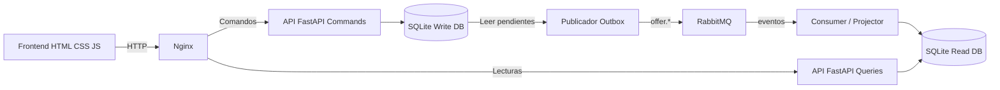

# EcoRescate — Plataforma de donaciones de alimentos

**Proyecto final de Diseño y Patrones Arquitectónicos · Especialización en Arquitectura de Software · CORHUILA · 2026B**

## 1. Problema y propuesta

Establecimientos pueden publicar lotes de alimentos aptos para donación con vencimiento y disponibilidad. Organizaciones sociales reservan unidades. El sistema impide reservar más inventario del disponible y actualiza la vista consultable y los indicadores a través de eventos. **No certifica inocuidad, realiza transporte ni reemplaza los controles sanitarios aplicables.**

## 2. Arquitectura



- **commands (8001):** API de publicación, reserva, cancelación y dominio puro. Persistencia SQLite privada. Invariantes de stock bajo `BEGIN IMMEDIATE`.
- **outbox:** lee los eventos guardados en la misma transacción y los publica en RabbitMQ con confirmación.
- **rabbitmq (15672):** exchange topic `ecorescate.events`, cola durable `ecorescate.readmodel`.
- **projector:** consume mensajes con ACK manual, registra el `event_id` en `inbox` y actualiza las proyecciones idempotentes.
- **queries (8002):** consulta disponibilidad, reservas y estadísticas en su propia base SQLite.
- **web (8080):** Nginx sirve la UI y hace proxy a ambas APIs, sin CORS.

**Importante:** el 201 confirma la escritura de la reserva, pero la pantalla consulta un read model *eventualmente consistente* que puede tardar en actualizar. Outbox no significa event sourcing ni garantiza una sola entrega; inbox deduplica eventos repetidos.

## 3. Requisitos

- Docker Desktop o Docker Engine + plugin Docker Compose v2.
- Navegador moderno.
- Para tests sin Docker: Python 3.11+ y `pip`.

## 4. Arranque con un comando

Desde la carpeta raíz del repositorio:

```bash
docker compose up --build -d
```

Abrir **http://localhost:8080**.

| Servicio | URL | Función |
|---|---|---|
| Frontend | http://localhost:8080 | Demo interactiva |
| API comandos | http://localhost:8001/docs | Swagger / operaciones |
| API consultas | http://localhost:8002/docs | Swagger / lectura |
| RabbitMQ Admin | http://localhost:15672 | Cola, eventos y conexiones |

Credenciales RabbitMQ por defecto para la **demo local únicamente**: `guest` / `guest`.

**En Windows:** abrir PowerShell en la carpeta descomprimida, verificar `docker compose version` y ejecutar el comando anterior. Si alguno de los puertos 8080, 8001, 8002 o 15672 está ocupado, liberar el puerto o cambiar el puerto a la izquierda en `docker-compose.yml`.

Ver logs:

```bash
docker compose ps
docker compose logs -f commands outbox projector queries
```

Cerrar sin borrar datos:

```bash
docker compose down
```

Eliminar todos los datos de la demo (irreversible):

```bash
docker compose down -v
```


## 5. Estructura profesional del proyecto

```text
EcoRescate_MVP/
├── command_service/
│   ├── domain.py              # Entidad Offer e invariantes
│   ├── ports.py               # Contrato OfferRepository
│   ├── application.py         # Casos de uso
│   ├── sqlite_adapter.py      # Transacciones y outbox
│   ├── sql/schema.sql         # Esquema de escritura
│   ├── api.py                 # Entrada HTTP FastAPI
│   └── outbox_worker.py       # Publicador RabbitMQ
├── query_service/
│   ├── projector.py           # Proyecciones + inbox idempotente
│   ├── sql/schema.sql         # Esquema de lectura
│   ├── consumer.py            # Consumidor RabbitMQ
│   └── api.py                 # Endpoints de lectura
├── web/
│   ├── index.html             # Marcado HTML
│   ├── css/styles.css         # Presentación visual
│   ├── js/app.js              # Interacciones y peticiones HTTP
│   └── nginx.conf             # Proxy inverso
├── tests/                     # Pruebas de casos críticos
├── .github/workflows/ci.yml  # Pipeline de pruebas
├── Dockerfile
├── docker-compose.yml
├── requirements.txt
└── README.md
```

