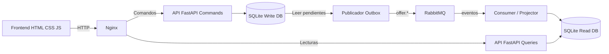

# ♻ EcoRescate — Plataforma de donaciones de alimentos

**Proyecto final de Diseño y Patrones Arquitectónicos · Especialización en Arquitectura de Software · CORHUILA · 2026B**

> MVP académico: microservicios, arquitectura hexagonal (Ports & Adapters), arquitectura orientada a eventos, CQRS, transactional outbox e inbox idempotente.

## 1. Problema y propuesta

Establecimientos pueden publicar lotes de alimentos aptos para donación con vencimiento y disponibilidad. Organizaciones sociales reservan unidades. El sistema impide reservar más inventario del disponible y actualiza la vista consultable y los indicadores a través de eventos. **No certifica inocuidad, realiza transporte ni reemplaza los controles sanitarios aplicables.**

## 2. Arquitectura



- **commands (8001):** API de publicación, reserva, cancelación y dominio puro. Persistencia SQLite privada. Invariantes de stock bajo `BEGIN IMMEDIATE`.
- **outbox:** lee los eventos guardados en la misma transacción y los publica en RabbitMQ con confirmación.
- **rabbitmq (15672):** exchange topic `ecorescate.events`, cola durable `ecorescate.readmodel`.
- **projector:** consume mensajes con ACK manual, registra el `event_id` en `inbox` y actualiza las proyecciones idempotentes.
- **queries (8002):** consulta disponibilidad, reservas y estadísticas en su propia base SQLite.
- **web (8080):** Nginx sirve la UI y hace proxy a ambas APIs, sin CORS.

**Importante:** el 201 confirma la escritura de la reserva, pero la pantalla consulta un read model *eventualmente consistente* que puede tardar en actualizar. Outbox no significa event sourcing ni garantiza una sola entrega; inbox deduplica eventos repetidos.

## 3. Requisitos

- Docker Desktop o Docker Engine + plugin Docker Compose v2.
- Navegador moderno.
- Para tests sin Docker: Python 3.11+ y `pip`.

## 4. Arranque con un comando

Desde la carpeta raíz del repositorio:

```bash
docker compose up --build -d
```

Abrir **http://localhost:8080**.

| Servicio | URL | Función |
|---|---|---|
| Frontend | http://localhost:8080 | Demo interactiva |
| API comandos | http://localhost:8001/docs | Swagger / operaciones |
| API consultas | http://localhost:8002/docs | Swagger / lectura |
| RabbitMQ Admin | http://localhost:15672 | Cola, eventos y conexiones |

Credenciales RabbitMQ por defecto para la **demo local únicamente**: `guest` / `guest`.

**En Windows:** abrir PowerShell en la carpeta descomprimida, verificar `docker compose version` y ejecutar el comando anterior. Si alguno de los puertos 8080, 8001, 8002 o 15672 está ocupado, liberar el puerto o cambiar el puerto a la izquierda en `docker-compose.yml`.

Ver logs:

```bash
docker compose ps
docker compose logs -f commands outbox projector queries
```

Cerrar sin borrar datos:

```bash
docker compose down
```

Eliminar todos los datos de la demo (irreversible):

```bash
docker compose down -v
```

## 5. Ejemplo paso a paso por HTTP

1. Publicar una donación. Sustituir `2026-12-31T20:00:00Z` por una fecha futura en UTC:

```bash
curl -X POST http://localhost:8001/offers \
  -H 'Content-Type: application/json' \
  -d '{"provider":"Panadería El Trigal","title":"10 panes integrales","category":"Panadería","zone":"Centro Neiva","quantity":10,"expires_at":"2026-12-31T20:00:00Z"}'
```

2. Copiar el `id` devuelto; reservar 3 unidades:

```bash
curl -X POST http://localhost:8001/offers/REEMPLAZAR_ID/claims \
  -H 'Content-Type: application/json' \
  -d '{"organization":"Fundación Horizonte","quantity":3}'
```

3. Consultar proyección y métricas:

```bash
curl http://localhost:8002/offers
curl http://localhost:8002/metrics
```

4. Para cancelar una reserva, reemplazar `REEMPLAZAR_CLAIM_ID`:

```bash
curl -X POST http://localhost:8001/claims/REEMPLAZAR_CLAIM_ID/cancel
```

**Nota:** la fecha del ejemplo puede quedar vencida al ejecutar el proyecto en otro momento; la interfaz web propone automáticamente una fecha futura.

## 6. Ejecución de tests

```bash
python -m venv .venv
# Windows:
.venv\Scripts\activate
# Linux/macOS:
# source .venv/bin/activate
pip install -r requirements.txt
python -m pytest -q
```

Las pruebas no necesitan RabbitMQ, pues prueban dominio, adaptadores SQLite, API de comandos, proyección e idempotencia en aislamiento.

## 7. Estructura profesional del proyecto

```text
EcoRescate_MVP/
├── command_service/
│   ├── domain.py              # Entidad Offer e invariantes
│   ├── ports.py               # Contrato OfferRepository
│   ├── application.py         # Casos de uso
│   ├── sqlite_adapter.py      # Transacciones y outbox
│   ├── sql/schema.sql         # Esquema de escritura
│   ├── api.py                 # Entrada HTTP FastAPI
│   └── outbox_worker.py       # Publicador RabbitMQ
├── query_service/
│   ├── projector.py           # Proyecciones + inbox idempotente
│   ├── sql/schema.sql         # Esquema de lectura
│   ├── consumer.py            # Consumidor RabbitMQ
│   └── api.py                 # Endpoints de lectura
├── web/
│   ├── index.html             # Marcado HTML
│   ├── css/styles.css         # Presentación visual
│   ├── js/app.js              # Interacciones y peticiones HTTP
│   └── nginx.conf             # Proxy inverso
├── tests/                     # Pruebas de casos críticos
├── .github/workflows/ci.yml  # Pipeline de pruebas
├── Dockerfile
├── docker-compose.yml
├── requirements.txt
└── README.md
```

## 8. Contratos y reglas de negocio

| Operación | Endpoint | HTTP |
|---|---|---|
| Publicar oferta | `POST /offers` (comandos) | 201 |
| Reservar unidades | `POST /offers/{id}/claims` (comandos) | 201 / 409 |
| Cancelar reserva | `POST /claims/{id}/cancel` (comandos) | 200 / 409 |
| Ver ofertas | `GET /offers` (consultas) | 200 |
| Ver reservas | `GET /claims` (consultas) | 200 |
| Ver KPIs | `GET /metrics` (consultas) | 200 |

**Eventos:** `offer.created`, `offer.reserved`, `offer.released`. Todos incluyen `event_id`, `event_type`, `occurred_at`, `schema_version` y `data`; dentro de `data`, una *instantánea* del estado completo de la oferta y, si aplica, la reserva. Una versión mayor evita que eventos retrasados hagan retroceder el estado de la oferta.

**Reglas:** fecha límite futura y con zona horaria; cantidad positiva; no reservar alimentos vencidos o sin stock; cancelar sólo reservas activas; no permitir stock negativo; reserva y evento outbox en un mismo commit.

## 9. ADR, evaluación y limitaciones

### ADR-001 · Decisión arquitectónica

**Contexto:** la reserva debe evitar stock negativo, mientras la vista de consulta puede tolerar retrasos breves.
**Decisión:** separar comandos y consultas; gestionar la reserva mediante transacción local y outbox;
publicar eventos persistentes en RabbitMQ; actualizar proyecciones con consumidor idempotente.
**Consecuencia:** desacoplamiento de lectura/escritura a cambio de más infraestructura,
consistencia eventual, reintentos y necesidad de monitoreo.

### Trazabilidad mínima de pruebas

| Escenario | Prueba |
|---|---|
| Reserva superior al stock o donación vencida | `test_domain_rejects_expired_and_excess` |
| Flujo HTTP, eventos e inbox idempotente | `test_api_and_cqrs_idempotent` |
| Reservas concurrentes sin sobreventa | `test_concurrent_claims_only_one_succeeds` |
| Fecha o cantidad inválidas | `test_reject_invalid_date_and_input` |
| Mensajes fuera de orden | `test_out_of_order_read_model_keeps_latest` |

Los diagramas UML completos de componentes, secuencia y despliegue forman parte del informe técnico entregado por separado. Este repositorio conserva un diagrama de arquitectura en Mermaid para evitar enlaces a documentos auxiliares.

**No implementado:** autenticación/autorización y roles, controles sanitarios, rutas, geolocalización, reconexión con jitter, métricas de producción, DLQ, reconstrucción automática desde histórico y migraciones SQL formales. No desplegar datos de personas reales en esta demo. SQLite resulta adecuado para aprendizaje, pero en despliegues multi-réplica se recomienda una base transaccional de servidor como PostgreSQL.

**Verificación:** las cinco pruebas automatizadas locales fueron ejecutadas correctamente.
El flujo de RabbitMQ requiere una prueba integral mediante Docker Compose; comprueba los contenedores,
publica una donación y verifica su reflejo eventual antes de exponer.

**Organización:** el HTML, CSS y JavaScript están en archivos distintos. Los esquemas SQLite
están en `command_service/sql/schema.sql` y `query_service/sql/schema.sql`;
el código Python los carga al inicializar cada servicio. Se trata de un bootstrap de MVP,
no de migraciones versionadas como Alembic.

## 10. Fuentes técnicas

- Cockburn, A. (2005). *Hexagonal architecture*. https://alistair.cockburn.us/hexagonal-architecture
- Lewis, J., & Fowler, M. (2014). *Microservices*. https://www.martinfowler.com/articles/microservices.html
- Microsoft. (s. f.). *CQRS pattern*. https://learn.microsoft.com/en-us/azure/architecture/patterns/cqrs
- Amazon Web Services. (s. f.). *Transactional outbox pattern*. https://docs.aws.amazon.com/prescriptive-guidance/latest/cloud-design-patterns/transactional-outbox.html
- RabbitMQ. (s. f.). *Consumer acknowledgements and publisher confirms*. https://www.rabbitmq.com/docs/confirms
